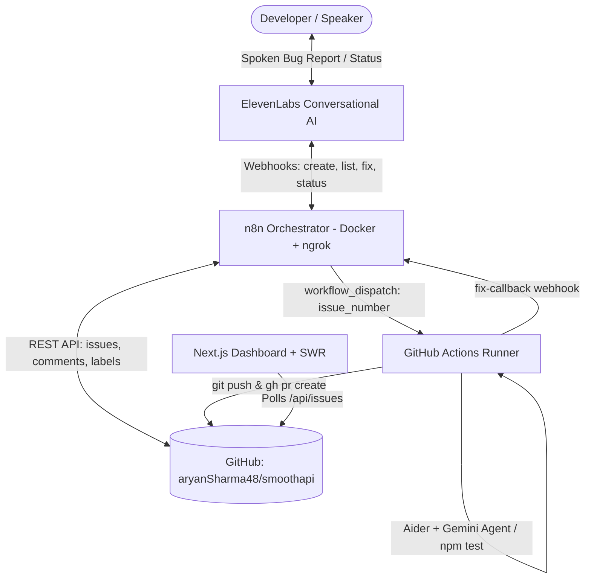

# VoiceBugBot 🤖🎙️

> **Voice-Controlled, Human-Approved Autonomous Bug Triage & Fix Pipeline**  
> File, list, and fix GitHub bugs entirely by voice — ending with a tested, reviewable Pull Request opened by a background coding agent.

Demonstrated live on [**aryanSharma48/smoothapi**](https://github.com/aryanSharma48/smoothapi) (dual-language TypeScript & Python API fault-tolerance library).

---

## ⚡ Core Value Proposition

1. **Zero Context Switching:** Developers speak a bug report into the web widget; AI gathers reproduction steps and files a structured, labeled issue.
2. **Autonomous Coding Agent:** Saying *"Fix issue N"* labels the ticket `WIP` and triggers a headless coding agent (`aider-chat` with Gemini) in GitHub Actions.
3. **Safety Guarantee:** **Zero auto-merge.** The agent runs tests in a sandbox VM, pushes to `fix/issue-N`, and opens a pull request. A human maintainer reviews the diff and approves.
4. **Live Reactive Dashboard:** A 4-column Next.js Kanban board updates in real-time as tickets progress from `Reported` → `WIP` → `Needs Review`.
5. **Zero Cost ($0):** Runs entirely on free tiers (self-hosted n8n in Docker, GitHub Actions on public repos, Gemini API free tier, Next.js on Vercel/local).

---

## 🏗️ System Architecture



---

## 📁 Repository Structure

```text
BugBot/
├── dashboard/                 # Next.js 16 live reactive status dashboard & voice embed
│   ├── src/app/api/issues/    # Cached GitHub API proxy (3s cache)
│   ├── src/components/        # Board, Header, Stats, IssueCard, IssueModal, VoiceWidget
│   └── src/app/globals.css    # Custom glassmorphic dark theme & animations
│
├── n8n/                       # Local orchestrator & workflow templates
│   ├── docker-compose.yml     # n8n Community Edition in Docker
│   └── workflows/             # 5 importable JSON workflow pipelines:
│       ├── create-issue.json  # Bug ingestion & LLM duplicate detection
│       ├── list-issues.json   # Natural language spoken summaries under 20s
│       ├── start-fix.json     # Atomically labels WIP and dispatches GitHub Action
│       ├── get-status.json    # Live query of issue labels and active PRs
│       └── fix-callback.json  # Post-run label swap to 'needs-review'
│
├── github-actions/            # Autonomous coding pipeline for target repo
│   └── bugbot-fix.yml         # Headless Aider + Gemini agent runner
│
├── elevenlabs/                # Voice agent prompts & tool definitions
│   ├── system-prompt.txt      # Prompt tuned for smoothapi triage
│   └── tools/                 # JSON schemas for create_issue, list_issues, start_fix, get_status
│
├── scripts/                   # Testing & rehearsal utilities
│   ├── setup-labels.ps1       # Creates the 11 BugBot labels on GitHub
│   ├── test-endpoints.ps1     # Tests all 5 webhooks via curl/PowerShell
│   └── reset-demo.ps1         # Resets issue labels and closes PRs between rehearsals
│
└── TECH_PRD.md                # Full technical product requirements document
```

---

## 🚀 Quick Start Guide

### Step 1: Initialize GitHub Labels
Run the label setup script with your GitHub Personal Access Token:
```powershell
.\scripts\setup-labels.ps1 -Repo "aryanSharma48/smoothapi" -Token "YOUR_GITHUB_PAT"
```

### Step 2: Install GitHub Actions in `smoothapi`
1. Copy [`github-actions/bugbot-fix.yml`](./github-actions/bugbot-fix.yml) into `smoothapi/.github/workflows/`.
2. In `smoothapi` repository settings (**Settings → Actions → General**):
   * Select **Read and write permissions**.
   * Tick **Allow GitHub Actions to create and approve pull requests**.
3. Add Repository Secrets (**Settings → Secrets and variables → Actions**):
   * `GEMINI_API_KEY`: Key from Google AI Studio
   * `N8N_CALLBACK_URL`: `https://YOUR-DOMAIN.ngrok-free.app/webhook/bugbot/fix-callback`
   * `N8N_SHARED_SECRET`: Random hex secret matching n8n

### Step 3: Start Local n8n Orchestrator
```bash
cd n8n
cp .env.example .env
docker compose up -d
```
1. Open [http://localhost:5678](http://localhost:5678) and create your account.
2. In a separate terminal, start your tunnel: `ngrok http 5678`.
3. In n8n credentials, add:
   * **Header Auth** (`x-bugbot-secret` = your shared secret)
   * **GitHub PAT** (with Issues, Pull Requests, and Actions permissions)
4. Go to **Workflows → Import from File** and import the 5 JSON files in `n8n/workflows/`. Activate each workflow.

### Step 4: Configure ElevenLabs Voice Agent
1. In [ElevenLabs Agents](https://elevenlabs.io/), create a blank agent named `BugBot`.
2. Paste the prompt from [`elevenlabs/system-prompt.txt`](./elevenlabs/system-prompt.txt).
3. Under **Tools**, add the 4 webhook tools using the schemas in [`elevenlabs/tools/`](./elevenlabs/tools/).
4. Copy your **Agent ID** from the Widget tab.

### Step 5: Launch the Dashboard
```bash
cd dashboard
cp .env.example .env.local
# Set NEXT_PUBLIC_AGENT_ID=your_elevenlabs_agent_id in .env.local
npm run dev
```
Open [http://localhost:3000](http://localhost:3000) to view the live reactive board.

---

## 🎙️ Spoken Demo Script

| Spoken Utterance | VoiceBot Action | Backend Effect |
| :--- | :--- | :--- |
| *"I found a bug. The timeout handler rejects immediately when set to 0 in smoothAPI."* | Asks follow-ups, reads back summary, asks for confirmation | Calls `create-issue` → Issue created with `reported`, `sev:medium`, and `comp:python` labels. Card appears under **Reported**. |
| *"What's open right now?"* | Reads the top open issues under 20 seconds | Calls `list-issues` (read-only). |
| *"Fix issue 1."* | Confirms issue title, requests verbal *"Yes"* | Calls `start-fix` → Issue moves to `WIP`. GitHub Actions workflow dispatches in background. |
| *"How is issue 1 going?"* | Reports live status and active workflow run | Calls `get-status` → Informs user that the coding agent is actively testing code. |
| *(Actions job completes)* | Card moves to **Needs Review** without page refresh | Actions calls `fix-callback` → Label becomes `needs-review`. Pull Request link appears on card. |

---

## 🔒 Safety & Guardrails

- **Spoken Double Confirmation:** The voice prompt demands a verbal *"Yes"*, and n8n rejects any mutating webhook if `confirmed !== true`.
- **Branch Protection:** GitHub Actions only pushes to isolated `fix/issue-N` branches. Pull requests require human approval.
- **Fail-Safe Callbacks:** GitHub Actions executes its callback step with `if: always()`, guaranteeing that failed builds flip the label to `fix-failed` rather than remaining silently stuck on `WIP`.
